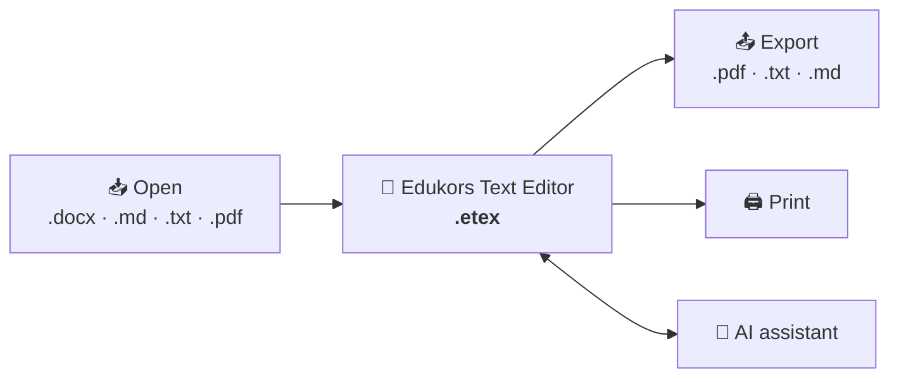

<p align="center">
  
</p>

<h1 align="center">Edukors Text Editor</h1>

<p align="center">
  A text editor that runs on your computer, with an AI assistant at your side.<br>
  Documents are laid out like Word's, on an A4 page, and <strong>open and save DOCX, Markdown, text and PDF</strong>.<br>
  More information at <a href="https://edukors.org"><strong>edukors.org</strong></a>.
</p>

<p align="center">
  <a href="https://github.com/mgarlabx/edukors_text_editor/releases/latest/download/Edukors-Text-Editor-windows.exe"></a>
  <a href="https://github.com/mgarlabx/edukors_text_editor/releases/latest/download/Edukors-Text-Editor-mac.dmg"></a>
  <a href="https://github.com/mgarlabx/edukors_text_editor/releases/latest/download/Edukors-Text-Editor-linux.AppImage"></a>
</p>

<p align="center">
  <a href="https://github.com/mgarlabx/edukors_text_editor/releases/latest"></a>
  <a href="LICENSE"></a>
</p>

<p align="center">
  <sub>Free, for Windows 10/11 (x64), macOS (Apple Silicon and Intel) and Linux (x64). See <a href="#download">Download</a> for the details.</sub>
</p>

## Part of Edukors.org

[Edukors.org](https://edukors.org) is a project of open tools for teaching and learning. The Text Editor is its word processor: made for teachers and writers who want a focused, Word-like page without depending on an online service or a heavy office suite.

The Edukors editors form a **suite of three free apps** for teachers, each for one kind of material: **documents**, **presentations** and **adaptive courses**. They run on your computer, are installed separately, and share the AI accounts you connect, so signing in once serves all three.

<table>
  <tr>
    <td width="33%" valign="top">
      <h3>📝 Text Editor</h3>
      <strong>This app</strong>, for documents laid out like Word's, opening and saving DOCX, Markdown, text and PDF.
    </td>
    <td width="33%" valign="top">
      <h3>🎞️ <a href="https://github.com/mgarlabx/edukors_slides_editor">Slides Editor</a></h3>
      For presentations, exported as a single HTML file that opens offline.
    </td>
    <td width="33%" valign="top">
      <h3>🗺️ <a href="https://github.com/mgarlabx/edukors_graph_editor">Graph Editor</a></h3>
      For adaptive courses in the <a href="https://github.com/mgarlabx/edukors_graph">Edukors Graph</a> format.
    </td>
  </tr>
</table>

### One document, one file

A document is saved in a single `.etex` file, a package laid out like a DOCX file, so it converts to and from Word. The editor also opens DOCX, Markdown, text and PDF files, and exports PDF, text and Markdown. Its interface, skills and AI accounts come from [Edukors Common](https://github.com/mgarlabx/edukors_common_ux), the shared foundation of the Edukors apps.



## What it is for

<table>
  <tr>
    <td width="33%" valign="top">
      <h3>✍️ Write</h3>
      Headings, lists, quotes, code, links, fonts, colors and alignment, with Markdown shortcuts while you type.
    </td>
    <td width="33%" valign="top">
      <h3>📄 See the page</h3>
      A continuous A4 page with 20 mm margins, and marks where each PDF page ends.
    </td>
    <td width="33%" valign="top">
      <h3>🧩 Insert</h3>
      Tables (merge, split, fill), shapes and pictures, resized and aligned right on the page.
    </td>
  </tr>
  <tr>
    <td width="33%" valign="top">
      <h3>🔎 Find and replace</h3>
      Match case and whole words; replacing keeps the formatting, and Replace all is a single undo.
    </td>
    <td width="33%" valign="top">
      <h3>🤖 Ask the AI</h3>
      Ask the assistant to write, rewrite, format, or add shapes and pictures; you approve each change.
    </td>
    <td width="33%" valign="top">
      <h3>📦 Export and print</h3>
      PDF, plain text or Markdown, and printing with the same page as the PDF.
    </td>
  </tr>
</table>

## How it works

**The page.** A document is a continuous page with the measures of the PDF's A4 page (20 mm margins). Dashed marks with the page number show where each PDF page ends; the switch at the end of the formatting bar hides them. A mark can be one line early, because the PDF moves a line that does not fit to the next page. Zoom (− and +, 50% to 200%) changes only the view, never the saved font sizes.

**Writing.** The formatting bar holds the style (paragraph, headings 1–3, quote, code), font, size in points, color, bold, italic, underline, strikethrough, subscript and superscript, alignment, lists and links. While typing, `# ` to `### ` start a heading, `- ` a bulleted list, `1. ` a numbered list, `> ` a quote and ```` ``` ```` a code block; in a list, Tab and Shift+Tab change the level. With the cursor in a link, a bubble shows its address; Cmd+click (Ctrl+click on Windows and Linux) opens it in the browser. Pasting from other programs keeps what a document can hold.

**Tables, shapes and pictures.** Insert table offers a grid to pick rows × columns (the first row is a header). Tab moves between cells, borders drag to change column widths, and the Table menu adds, deletes, merges and splits rows and columns, toggles the header row and sets the cell fill. Shapes come from Edukors' catalog of ten; pictures can be PNG, JPEG, GIF, WebP, SVG, BMP or AVIF, up to 50 MB. Both sit between paragraphs, aligned left, center or right, with a resize handle; shapes also take line width, style and color, fill, shadow and opacity.

**Find and replace.** Cmd+F (Ctrl+F), or the magnifier at the end of the bar, opens a panel at the top right; Option+Cmd+F (Ctrl+H) adds the replace field. Matches are highlighted and counted ("2 of 9"); Enter and Shift+Enter, or Cmd+G and Shift+Cmd+G (F3 and Shift+F3), move between them.

**The AI assistant.** A panel reads the document as numbered blocks and changes it with tools: inserting and replacing content, setting block styles, formatting text, replacing text, and inserting shapes and pictures (a file, a web address or SVG). Each change is one undo step and, in Review mode, waits for your approval. The assistant runs on **Claude Code** or **Codex**, installed on your computer, with an AI account you connect in the editor; accounts, skills and conversations are shared with the other Edukors apps. Each document keeps its own conversations.

**Files.**

| Format | Open | Save | Export |
| --- | :---: | :---: | :---: |
| **`.etex`** (the editor's own) | ✅ | ✅ | |
| **DOCX** | ✅ | Save As `.etex` | |
| **Markdown** (`.md`) | ✅ | ✅ in place, or as source | ✅ |
| **Plain text** (`.txt`) | ✅ | ✅ in place | ✅ |
| **PDF** | ✅ text only | Save As `.etex` | ✅ A4, 20 mm margins |

An `.etex` is a package laid out like a DOCX file, so it can be converted to and from Word: the document's content, its pictures and its AI conversations, checked strictly when opened. Double-clicking an `.etex` opens the editor. When saving over an existing file, the editor asks before replacing it.

## Download

| System | Download | Requirements |
| --- | --- | --- |
| **Windows** | Microsoft Store (coming soon) | Windows 10 or 11, 64-bit (x64) |
| | [Edukors-Text-Editor-windows.exe](https://github.com/mgarlabx/edukors_text_editor/releases/latest/download/Edukors-Text-Editor-windows.exe) | The same, for schools that block the Microsoft Store |
| **macOS** | [Edukors-Text-Editor-mac.dmg](https://github.com/mgarlabx/edukors_text_editor/releases/latest/download/Edukors-Text-Editor-mac.dmg) | Apple Silicon or Intel |
| **Linux** | [Edukors-Text-Editor-linux.AppImage](https://github.com/mgarlabx/edukors_text_editor/releases/latest/download/Edukors-Text-Editor-linux.AppImage) | 64-bit (x64) |
| | [Edukors-Text-Editor-linux.deb](https://github.com/mgarlabx/edukors_text_editor/releases/latest/download/Edukors-Text-Editor-linux.deb) | Optional, for Debian, Ubuntu, Mint and their relatives |

The links always give the latest version; every version is on the [releases](https://github.com/mgarlabx/edukors_text_editor/releases) page. Each release lists the SHA-256 checksum of every file (`SHA256SUMS.txt`) and carries a GitHub build provenance attestation (`gh attestation verify <file> -R mgarlabx/edukors_text_editor`).

**On Windows**, the Microsoft Store version is on its way. Meanwhile, or if your school blocks the Store, download the `.exe` installer. Windows may show security warnings: in the browser, keep the file; on the **Windows protected your PC** warning, click **More info** and then **Run anyway**.

**On macOS**, a `.dmg` file, signed and notarized by Apple. Open the file and drag the app into the **Applications** folder.

**On Linux**, an `.AppImage` file. Make the file executable (`chmod +x`) and open it, no installation needed. On Debian, Ubuntu and their relatives, the `.deb` is an alternative that adds the editor to the applications menu and opens `.etex` files with a double click: `sudo apt install ./Edukors-Text-Editor-linux.deb`.

**Help and terms of use.** The Help button opens a quick guide and the terms of use (the MIT license, explained), which the editor asks you to accept the first time it opens. The interface is available in English, Portuguese and Spanish.

**Updates.** The app checks this repository's releases and says when a new version is out.

**Optional: the AI assistant.** Install [Claude Code](https://claude.com/claude-code) (`claude`) or [Codex](https://developers.openai.com/codex/cli/) (`codex`) on your computer; the editor never downloads them for you. Then add an account in the editor and sign in. The accounts are shared with the other Edukors apps on this computer.

## Building from source

Requirements: [Node.js](https://nodejs.org) 22.12 or later, npm and git (Edukors Common is installed from its GitHub repository).

```sh
git clone https://github.com/mgarlabx/edukors_text_editor.git
cd edukors_text_editor
npm install
node node_modules/electron/install.js   # once, if npm skipped Electron's download (npm 12 blocks install scripts)
npm start                               # builds dist/ (tools/build.mjs), then opens the app
```

`npm run package` builds this system's installers into `release/`. The published installers, for all three systems, are built on GitHub by the release workflow that runs when a version tag is pushed; signing, notarization, releases and the Microsoft Store package are described in [docs/distribution.md](docs/distribution.md).

## Project status

The editor is young and evolving. It runs on macOS (universal: Apple Silicon and Intel), signed and notarized by Apple, on Windows (x64; the installer on GitHub is not signed, and the signed version comes through the Microsoft Store) and on Linux (x64).

## For developers

The app is built with [Electron](https://www.electronjs.org) and [ProseMirror](https://prosemirror.net) on [Edukors Common](https://github.com/mgarlabx/edukors_common_ux), the shared foundation of the Edukors apps, which provides the window, toolbar, tabs, files, settings, help, update notice and the AI assistant.

```sh
npm test                                # builds, then runs tests/ (schema, file, Markdown, text, DOCX, AI operations, find and replace)
npm run build && npx electron . [--shared | --data-dir <dir>]
```

Unpackaged, the AI accounts live in a development registry apart from the other Edukors apps, with a fake service for testing; `--shared` uses the real shared accounts, `--data-dir` another folder. To work on Common at the same time, link the sibling folder: `npm link ../edukors_common_ux`.

### What this app supplies

Everything else comes from Common (see its `docs/common-shell.md`, "App integration"):

| Path | Role |
| --- | --- |
| `index.html` | Loads `app-config.js`, then Common's `src/shell/boot.js` with this app's scripts |
| `app-config.js` | Name, version (`v.YY.MM.DD`), terms version, `.etex`, export and import formats, help texts; `sidebar: false` turns off the left sidebar |
| `src/editor/schema.js` | What a document may contain, every attribute validated |
| `src/editor/index.js` | The editing surface, formatting bar, Edit and Insert buttons |
| `src/editor/media.js`, `tables.js` | Pictures and shapes on the page; Insert table's size grid |
| `src/editor/pages.js`, `search.js` | Page-break marks; find and replace |
| `src/editor/ai.js` | The assistant's operations |
| `src/editor/convert.js`, `editor.css` | Export and import; the page's styles |
| `document.js` | `EdukorsAppDocument`: the `.etex` package (`text/document.json`, pictures in `text/media/`, AI conversations), export and import through the editor |
| `assistant.js` | The AI assistant's instructions and tools (their argument types) |
| `desktop/main.mjs` | `startDesktopApp` from Common with this app's id, name and extension |
| `electron-builder.yml`, `build/` | Installers, icon (`build/icon.svg`; `npm run icons` renders the PNGs), macOS entitlements |
| `tools/` | `build.mjs` (the bundle), `package.mjs` (installers), `public-installers.mjs` (fixed download names), `store-screenshots.mjs` and `store-sample.mjs` (Microsoft Store pictures) |

`src/editor/` is bundled by esbuild into `dist/editor.js` and `dist/editor.css` (`tools/build.mjs`).

### Releases

Versions are release dates: `package.json` 26.11.4 is `v.26.11.04` in `app-config.js`; keep both the same. Set the version, commit, push, then `git tag v26.11.4 && git push origin v26.11.4`: `.github/workflows/release.yml` tests against the **latest Edukors Common**, builds, signs and notarizes the installers, publishes them in a GitHub release, and sends the MSIX to the Microsoft Store (`.github/workflows/store.yml`). The details, secrets included, are in [docs/distribution.md](docs/distribution.md).

## License

[MIT](LICENSE). Copyright (c) 2026 Edukors.
